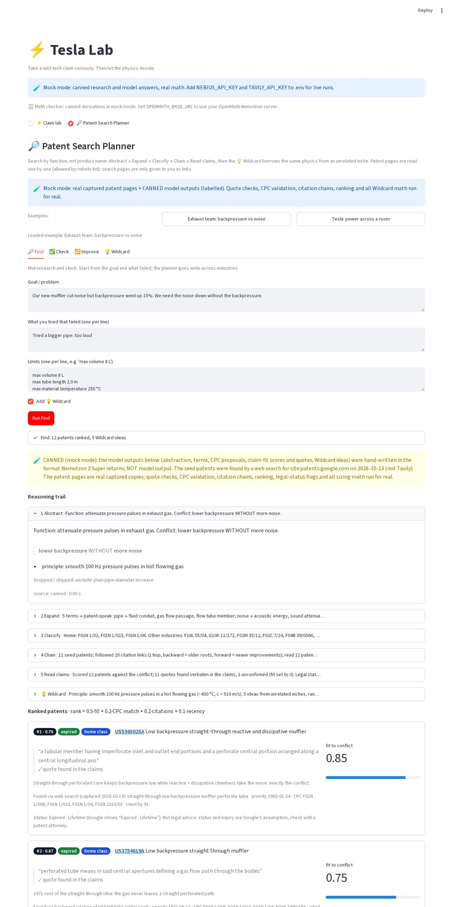
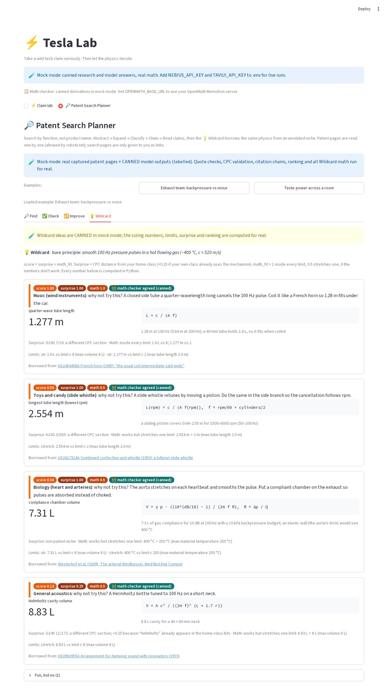
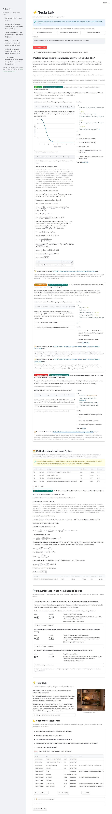
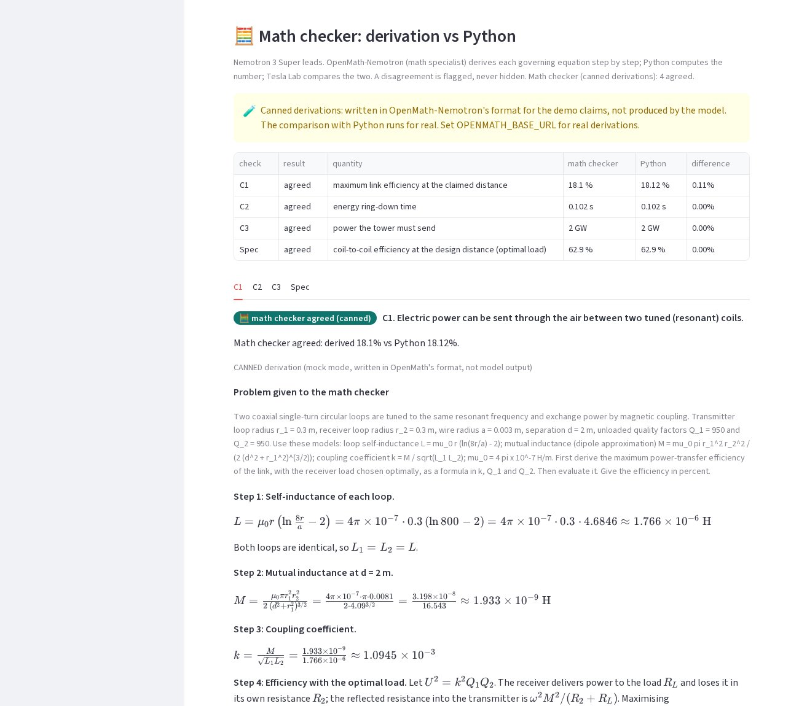

# ⚡ EVIE (Hardware AI Co-Pilot)

> *Inspired by Spider-Man's tactical assistant — take a wild hardware idea or physics claim seriously. Then let the physics decide.*

Type a fringe claim or mechanical hardware idea ("Tesla's tower could send free power anywhere on Earth" or a parametric kinematic mechanism). EVIE:

1. **Researches** it with **Tavily** (search + extract): original patents, papers, modern work, debunks.
2. **Extracts** the concrete physical claims and the numbers behind them with **NVIDIA Nemotron on Nebius Token Factory**.
3. **Computes** the physics in Python. Nemotron never does arithmetic in its head: it *picks* a vetted calculator (or writes a small SymPy/NumPy snippet) and Python runs it in a sandbox.
4. **Rules** on each claim: ✅ **WORKS** / 🧩 **MISSING PIECE** / ⛔ **BREAKS PHYSICS**, with sources. A guardrail lets the math overrule the model.
5. **Designs** a modern product from the part that works, plus an image prompt (optional render).

**New in v2**

6. **Product Design Engine**: the math doesn't just judge, it *designs*. A vetted design calculator
   sizes the product (coil diameter/turns, frequency, Q, coupling and efficiency vs distance, power,
   ICNIRP exposure screen; disc-pump discs/gap/motor; hydrogen tank/electrolyser/solar), adds a rough
   BOM, and writes the **render prompt from the computed numbers**. Spec sheet as JSON, Markdown and PDF.
7. **Innovation loop**: for every MISSING PIECE, a ranked "what would need to be true" list, each item
   backed by live **Tavily** + **arXiv** results showing who is working on it now.
8. **Tesla Archive (RAG)**: Tesla's original patents (and any CIA / FBI Vault / arXiv PDFs you add)
   indexed locally and cited by **document + page**, merged with Tavily's live web results.
9. **Eval set**: 20 well-known claims with expected verdicts, `scripts/run_eval.py` scoreboard, and a
   `--baseline` plain-chatbot comparison.

**New in v3: two NVIDIA models + a math checker**

10. **OpenMath-Nemotron as the math consultant.** Nemotron 3 Super (Token Factory) stays the lead. For every
    claim and for the product spec, NVIDIA's **OpenMath-Nemotron** (self-hosted on your Nebius GPU VM with vLLM)
    derives the governing equation step by step. Python still computes the number, and Tesla Lab **cross-checks**
    the two: each verdict carries "🧮 math checker agreed" or "math checker DISAGREED" (flagged for review, never
    silently overruled). The derivation steps are in the UI (new **Math checker** panel, per-claim expander, spec
    tab) and in the JSON (`verdicts[].math_check`, `spec.math_check`, `math_checker`).
    Setup, GPU sizing and what your $100 of credit buys: [`deploy/openmath/README.md`](deploy/openmath/README.md).

**New in v4: Patent Search Planner + 💡 Wildcard**

11. **Patent Search Planner** (new view "🔎 Patent Search Planner", CLI `--plan`). Search patents by *function*, not
    product name, in 5 steps: **Abstract** (function + conflict: "lower backpressure WITHOUT more noise") →
    **Expand** (synonyms + patent-speak: "fluid conduit", not "pipe") → **Classify** (CPC codes for your class, plus
    the same function in other industries' codes) → **Chain** (backward + forward citations, 1 hop) → **Read claims**
    (fit score to the conflict, backed by a quote that must appear verbatim in the claims, plus legal status;
    *not legal advice*). Three modes:
    - **Find**: mid-research and stuck; start from the goal + what failed; goes wide across industries.
    - **Check**: vet an idea; narrow and deep in your own class, every claim read, a date filter marks prior art.
    - **Improve**: feed in test results / new limits; re-runs, shows what's new / dropped / re-ranked, and gives a
      "new filings since" watch link. (The 3D-printed prototype loop is roadmap only.)
12. **💡 Wildcard**: strips the problem to its bare physics ("smooth 100 Hz pressure pulses in a hot flowing gas"),
    borrows from unrelated niches (wind instruments, heart and arteries, toys, kitchen, nature, other CPC sections)
    and ranks ideas by **surprise × math_fit**, where math_fit comes from a real Python sizing number checked
    against your limits (and re-derived by the OpenMath checker when configured). Exhaust example, reproducible
    in mock mode: quarter-wave tube **1.28 m** @ 100 Hz, c ≈ 510 m/s; Helmholtz cavity **8.8 L**; owl-feather
    serrations act near 64 kHz → "fun, but no".

**Hackathon deadline: Fri Oct 30 2026, 10:00 am PDT = Sat Oct 31, 1:00 am Malaysia time (MYT).**









Output is a structured JSON verdict (`tesla_lab/schema.py`), shown in a Streamlit UI.

---

## Run it in 60 seconds (no keys, mock mode)

```bash
python -m venv .venv && source .venv/bin/activate      # Windows: .venv\Scripts\activate
pip install -r requirements.txt
streamlit run app.py                                    # opens http://localhost:8501
```

Command line instead: `python -m tesla_lab --mock --out report.json --spec-out spec.pdf`
Tests: `pytest -q` (121 tests: 83 from v3 + 38 for the v4 planner: robots/fetcher, ranking, CPC, sizing, mocked Tavily/BigQuery/Nemotron, skip paths, CLI, planner UI).
Patent Search Planner from the command line (mock):

```bash
python -m tesla_lab --mock --plan find --example exhaust --plan-out plan.json
python -m tesla_lab --mock --plan check --example exhaust --before 2000-01-01
python -m tesla_lab --mock --plan improve --last-plan plan.json \
    --test-result "1.28 m tube cut the 100 Hz drone by 9 dB but is too long" --constraint "max tube length 1.0 m"
python -m tesla_lab --mock --plan find --example tesla_wireless
```
Print the derivations in the terminal: `python -m tesla_lab --mock "Tesla turbine" --show-derivations`

Mock mode uses research captured from the real Tavily API (2026-10-12), gap-search evidence captured
from the real Tavily + arXiv APIs (2026-10-13), and hand-written stand-ins for Nemotron's answers.
The math checker's derivations are **canned** in mock mode unless you set `OPENMATH_BASE_URL`: hand-written in
OpenMath-Nemotron's answer format for the 3 demo ideas and labelled "canned" everywhere. The comparison
with Python runs for real.
**Not canned**: the physics calculators, the design calculators and spec sheet, the gap ranking, and the
Tesla Archive search all run for real on every mock run (the archive is a real local index of 6 patents).

## Go live

```bash
cp .env.example .env        # add NEBIUS_API_KEY and TAVILY_API_KEY
python scripts/check_nebius.py   # lists the Nemotron ids your key can call + a test chat
python scripts/check_tavily.py   # one test search
streamlit run app.py             # auto-switches to live when both keys are set
```

Optional, v3: start your OpenMath-Nemotron VM (`deploy/openmath/`), open the SSH tunnel, set
`OPENMATH_BASE_URL=http://localhost:8000/v1` and run `python scripts/check_openmath.py`. Without it the
checker is skipped and the app says so. Remember to stop the VM (`deploy/openmath/stop_vm.sh`).

- Nebius key: https://tokenfactory.nebius.com (sign in with Google/GitHub, create API key)
- Tavily key: https://app.tavily.com (1,000 free credits/month, no card)
- Want to try Tavily before signing up? `TAVILY_KEYLESS=1` uses Tavily's rate-limited keyless mode
  (testing only; use your own key for the demo and the Tavily prize).

## How it fits the hackathon rules

| Requirement | Where |
|---|---|
| Runtime call to Nebius Token Factory | `tesla_lab/llm.py` (OpenAI SDK, `base_url=https://api.tokenfactory.nebius.com/v1/`) |
| NVIDIA open model | Nemotron: `NEMOTRON_MODEL` (extraction, concept) and `NEMOTRON_FAST_MODEL` (verdicts) |
| Second NVIDIA open model (v3) | OpenMath-Nemotron 7B/14B on a Nebius AI Cloud GPU VM via vLLM: `tesla_lab/openmath.py`, `deploy/openmath/` |
| Tavily bonus: functional runtime call | `tesla_lab/research.py` (`/search` then `/extract`) and `tesla_lab/gaps.py` (gap search, `time_range=year`) |
| Complete product, not a PoC | Streamlit UI, JSON export, charts, code view, product render |

## Architecture

```
claim text
   │
   ▼
[1] research.py ── Tavily /search (3 angles: primary source, modern research, debunk)
   │               Tavily /extract on the top 3 pages
   ▼  sources S1..Sn
[2] llm.py + prompts.EXTRACT ── Nemotron → 2-4 claims, each with sourced quantities
   │                             and a CalcSpec: {template + params} or {custom_code}
   ▼
[3] calc_runner.py ── calcs/ (7 vetted templates)  or  sandbox.py (AST check +
   │                  isolated subprocess, CPU/mem/time limits; optional Nebius Sandboxes)
   ▼  numbers + flags (e.g. violates_energy_conservation)
[4] prompts.VERDICT ── Nemotron writes the verdict + explanation
   │  pipeline.apply_guardrails ── math overrules the model (free energy is always BREAKS PHYSICS)
   ▼
[5] prompts.CONCEPT ── product concept + image prompt for the WORKS claim
   │  (optional) Token Factory /images/generations render
   ▼
[6] v3 mathcheck.py ── per claim + spec: a maths problem with the same inputs
   │   (vetted templates: built in code; custom code: Nemotron writes it)
   │   → OpenMath-Nemotron (your vLLM server) derives step by step, answer in \boxed{}
   │   → latexmath.py parses it (number or formula, SymPy) → compare with the Python number
   ▼  agreed / DISAGREED / inconclusive / skipped, steps + key equations
Report (schema.py) → Streamlit UI (app.py) / CLI JSON
```

Calculator templates (`tesla_lab/calcs/__init__.py`): `resonant_coupling` (efficiency vs distance),
`broadcast_spreading` (inverse-square), `earth_resonator` (Q, ring-down), `energy_balance`,
`electrolysis_loop`, `disc_turbine`, `carnot_limit`. Add your own: write a function returning the
`CalcResult` fields and register it in `TEMPLATES`; Nemotron sees its docstring automatically.


## v2 features in detail

### 1. Product Design Engine (`tesla_lab/design/`, `tesla_lab/spec_sheet.py`)
After the verdicts, the WORKS claim's concept names a design calculator and its requirements
(Nemotron picks them in live mode; `concept.design` / `concept.requirements` in mock). The calculator
returns a `ProductSpec`: every number tagged **req** (your requirement), **calc** (computed),
**assumed** (check on a prototype) or **est.** (cost estimate).

| Calculator | Sizes | Physics |
|---|---|---|
| `wireless_power` | tx/rx coil turns, L, C, capacitor voltage, Q, k(d), efficiency(d), amplifier power, coil current, exposure screen | exact coaxial-loop mutual inductance (elliptic integrals), skin-effect + radiation + capacitor ESR, η = U²/(1+√(1+U²))², on-axis H-field vs ICNIRP |
| `disc_pump` | disc diameter, gap, number of discs, stack length, shaft power, motor, running cost vs centrifugal | tip speed from head coefficient, boundary layer √(ν/ω), ρgQH |
| `h2_backup` | kg H₂, tank volume/cylinders, electrolyser kW, extra PV, water, round trip, battery cost crossover | LHV 33.33 kWh/kg, real-gas density, stoichiometry |

Exposure limits (general public), **verified 2026-10-13 against the PDFs**:
ICNIRP (2020) Table 5 whole-body H = 2.2/f(MHz) A/m and Table 6 local H = 4.9/f(MHz) A/m for 0.1–30 MHz
(https://www.icnirp.org/cms/upload/publications/ICNIRPrfgdl2020.pdf); ICNIRP (2010) Table 4, H = 21 A/m for
3 kHz–10 MHz (https://www.icnirp.org/cms/upload/publications/ICNIRPLFgdl.pdf).
**The screen is approximate**: it compares the on-axis peak field with reference levels meant for
body-averaged fields. Real compliance needs measurement or SAR simulation.

The demo's honest result: the Tesla Shelf delivers 10 W at 0.5 m at ~63% coil-to-coil efficiency, but at
full power the field on the coil axis exceeds the whole-body reference level out to ~0.85 m, so the spec
says "keep people ~0.85 m from the coil axis, or run under ~0.6 W". That is the kind of pushback judges like.

BOM prices are rough estimates (typical list prices for one-off prototypes), marked as such everywhere.
In the UI: spec card with tabs (specs, chart, safety screen, BOM, the calculator's code) and download
buttons for Markdown, PDF and JSON. CLI: `--spec-out spec.pdf` or `spec.md`.

### 2. Innovation loop / gap search (`tesla_lab/gaps.py`)
For each MISSING PIECE, Nemotron (fast model) writes 2–4 "what would need to be true" requirements with a
measurable target, a feasibility judgment (0–1), a web query and an arXiv query. Tavily (`time_range=year`)
and the arXiv API (no key; ~1 request / 3 s, with back-off) look for current work. Ranking is transparent:
`score = 0.6 × feasibility + 0.4 × min(1, evidence/3)`, evidence = Σ relevance × 0.5^(age_years/2).
Social-media hits and weak matches are filtered out. `python scripts/capture_gap_mock.py` refreshes the
mock data with real results (works with `TAVILY_KEYLESS=1`). Turn off with `GAP_SEARCH=0`.

### 3. Tesla Archive (`tesla_lab/archive.py`, `scripts/ingest_archive.py`, `archive/`)
Ships with 6 public-domain US patents downloaded from Google Patents (all text pages have an OCR layer):
US 645,576 and 649,621 (1900, transmission of electrical energy), US 787,412 (1905, through the natural
mediums), US 1,119,732 (1914, the Wardenclyffe apparatus), US 1,061,206 (1913, turbine) and
Stanley Meyer's US 4,936,961 (1990, fuel gas). PDFs are split by page, OCR noise cleaned, chunked
(~900 chars, 150 overlap), indexed, and searched with BM25 (default, no download) or hybrid BM25 +
embeddings. Hits come back as "US 787,412 ..., page 5" with a snippet, and in live mode they are passed to
Nemotron as sources A1, A2... next to Tavily's S1, S2... (`merge_evidence` interleaves them by rank).

```bash
python scripts/ingest_archive.py                                  # re-index archive/pdfs/
python scripts/ingest_archive.py --patent US382280A US685957A     # add more patents from Google Patents
python scripts/ingest_archive.py --arxiv "resonant wireless power transfer" --max 5
python scripts/ingest_archive.py --embedder st                    # semantic (pip install -r requirements-optional.txt)
python scripts/ingest_archive.py --embedder nebius                # Token Factory embeddings, needs NEBIUS_API_KEY
python -m tesla_lab.archive "stationary waves in the earth"       # search from the terminal
```
Manual sources (download in a browser, drop into `archive/pdfs/`, add a line to `archive/sources.json`):
- **FBI Vault, Nikola Tesla**: https://vault.fbi.gov/nikola-tesla — returns HTTP 403 to scripts (checked 2026-10-13).
- **CIA reading room**: https://www.cia.gov/readingroom — search "Tesla"; scripted search redirects (302), so download by hand.
- Scanned PDFs with no text layer need OCR: `pip install pytesseract pdf2image` plus the tesseract and poppler binaries.

Licensing: US patents are public records (US patent text is generally not subject to copyright);
FBI/CIA FOIA releases are US-government works. arXiv papers keep their authors' licences: index them for
your own search, cite them, and don't redistribute the PDFs unless the licence allows it.

Embeddings on Token Factory: the docs show `POST /v1/embeddings` (OpenAI-compatible) with example model
`BAAI/bge-en-icl` (https://docs.tokenfactory.nebius.com/api-reference/examples/create-embeddings).
Not tested with a key; set `NEBIUS_EMBED_MODEL` if your catalogue lists a different embedding model.

### 4. Eval set (`evals/claims.jsonl`, `scripts/run_eval.py`)
20 well-known claims (5 WORKS, 6 MISSING PIECE, 9 BREAKS PHYSICS), each with the expected verdict and,
where a solid one exists, a reference number + source (Carnot, Betz, Shockley–Queisser, NIF 2022 gain,
MIT 2007 coil efficiency, ...).

```bash
python scripts/run_eval.py              # no keys: runs the 3 demo claims (canned extraction, real math), marks the rest "needs live run"
python scripts/run_eval.py --live       # every claim through Tavily + Nemotron (~20 runs: watch your credits)
python scripts/run_eval.py --live --baseline   # + the same claims to a plain chat model, no tools, no math
```
Writes `evals/results/scoreboard-<mode>-<time>.md` and `.csv`: verdict accuracy and numeric error for
Tesla Lab vs the baseline. Nothing is filled in by hand; an item that didn't run says so. The 3 mock items
are graded against canned extractions written for the demo, so they show that the plumbing works, not how
accurate the system is. Only a `--live` run measures that.

## v3: the math checker in detail (`tesla_lab/mathcheck.py`, `openmath.py`, `latexmath.py`)

| Status | Meaning |
|---|---|
| agreed | OpenMath's boxed answer is within `MATH_CHECK_TOLERANCE` (2%) of the Python number, or within the Python value's own rounding. A fraction-vs-percent or m-vs-mm slip (×100 / ×1000) still counts and is stated. |
| DISAGREED | Outside tolerance. Shown in red on the verdict and listed in the notes. The verdict is not changed: Python is the calculator of record, the disagreement means "a human should look". |
| inconclusive | No `\boxed{}` answer (e.g. it ran out of tokens), an answer that can't be parsed, or nothing numeric to compare. Never guessed. |
| skipped / error | No endpoint configured / `MATH_CHECK=0`, or the call failed (timeout, server down). The run continues. |

- Problems for the 7 vetted templates and the 3 design calculators are built in code from the exact inputs
  Python used (e.g. "derive τ in terms of Q and f₀, then compute τ"); custom-code claims get a problem written
  by Nemotron 3 Super (`prompts.MATHCHECK_PROBLEM_SYSTEM`).
- If OpenMath boxes a formula, it is evaluated at the inputs and compared symbolically with the calculator's
  formula (SymPy `simplify`): "formula: same as the calculator's".
- Prompt and settings follow NVIDIA's model card (see `deploy/openmath/README.md`). All checks of a run are sent
  in parallel (vLLM batches them).
- JSON: `verdicts[i].math_check` = {status, headline, problem, steps[], key_equations[], final_answer_latex,
  checker_value, python_value, rel_diff, tolerance, symbolic_match, model, latency_s, ...};
  `spec.math_check`; `math_checker` = run summary.

## v4: Patent Search Planner + 💡 Wildcard in detail (`tesla_lab/patents/`, `tesla_lab/ui_planner.py`)

| File | What it does |
|---|---|
| `patents/planner.py` | The 5 steps, mode emphasis, ranking, Improve diff + watch link, `SearchPlan` JSON save/load |
| `patents/gpatents.py` | Robots-respecting reader for individual Google Patents pages (claims, CPC, Patent Citations, Cited By, legal status), disk cache, search-link builder |
| `patents/sources.py` | Tavily discovery (`include_domains=["patents.google.com"]`, keeps `/patent/` URLs only); optional BigQuery (Google Patents Public Datasets) |
| `patents/brain.py` | Nemotron 3 Super prompts (abstract, expand, classify, claim scoring, principle, transfer) + the canned mock brain |
| `patents/cpc.py`, `patents/data/cpc_titles.json` | CPC normalising, validation, title matching, distance between codes |
| `patents/wildcard.py`, `patents/sizing.py` | Far niches, surprise score, Python sizing calculators, limits → math_fit, OpenMath cross-check |
| `mock/planner/` | Canned examples (`exhaust`, `tesla_wireless`), captured patent pages, canned derivations |

**Google Patents rules.** `patents.google.com/robots.txt` (read 2026-10-13) is `Disallow: /*` with `Allow: /patent/`,
so search result pages (`/?q=…`) are off limits to scripts. Tesla Lab only ever requests
`https://patents.google.com/patent/<number>/en` (allowlist + robots evaluator, checked *before* any request; one
request per second; cached in `cache/patents/`). Search pages are only handed to **you** as clickable links (home class,
each cross-industry class, keywords only, and for Check a `before=priority:` date filter).

**Ranking.** `rank = 0.5 fit + 0.2 CPC match + 0.2 forward citations (log) + 0.1 recency`. Fit is 0 unless the model's
quote is found verbatim in the claims. Check lists prior art first; Improve lists new patents first.

**Wildcard score.** `surprise × math_fit`. Surprise = CPC distance from your home class (another section = 1.0),
×0.25 if the mechanism already shows up in your home-class hits. math_fit = 1.0 inside every limit, 0.5 if it works
but stretches one limit, 0 if the physics doesn't apply. Ideas with math_fit 0 are shown as "fun, but no".

**Live mode.** Needs `NEBIUS_API_KEY` (Nemotron 3 Super) and `TAVILY_API_KEY`. BigQuery is off unless
`PATENTS_BIGQUERY=1` + `GOOGLE_CLOUD_PROJECT` + Google credentials (`pip install google-cloud-bigquery`); without them it is
skipped with a note, and a dry-run byte cap (`PATENTS_BQ_MAX_GB`, default 20) stops expensive queries.

**Mock mode.** The patent pages are real captured copies; the model outputs (abstraction, terms, CPC proposals,
claim scores and quotes, Wildcard ideas) are **canned**, hand-written in Nemotron's format, and labelled CANNED in the
UI, CLI and JSON. Quote checks, CPC validation, citation chains, ranking, legal-status flags and all sizing math run
for real.

## Project layout

```
app.py                     Streamlit UI
tesla_lab/
  config.py                env + mode (mock/live/auto), model ids
  schema.py                Pydantic models = the JSON verdict format
  research.py              Tavily search + extract
  llm.py                   Nemotron client (JSON schema → JSON object → text fallback)
  prompts.py               honesty rules + step prompts
  calcs/__init__.py        vetted physics calculators
  sandbox.py               safe runner for model-written code
  calc_runner.py           runs a CalcSpec, exposes the source shown in the UI
  pipeline.py              the 5 steps + guardrails
  cli.py                   python -m tesla_lab
  mock/demos.json          3 demo claims (captured Tavily results + canned model output)
  mock/renders/            concept renders for the 3 demos
  design/                  v2: product design calculators (wpt, disc_pump, h2_storage) -> ProductSpec
  spec_sheet.py            v2: spec sheet as Markdown / PDF
  gaps.py                  v2: innovation loop (Tavily + arXiv, ranked "what would need to be true")
  archive.py               v2: Tesla Archive (PDF pages -> chunks -> BM25 / embeddings -> cited hits)
  mock/gaps.json           v2: captured Tavily + arXiv evidence for mock mode
archive/                   v2: sample archive (6 patent PDFs, sources.json, prebuilt index/)
evals/claims.jsonl         v2: 20-claim eval set
scripts/ingest_archive.py  v2: download patents / arXiv papers, build the index
scripts/run_eval.py        v2: eval scoreboard (+ --baseline)
scripts/capture_gap_mock.py v2: refresh mock gap-search data with real results
scripts/check_nebius.py    list models on your key, test chat
scripts/check_tavily.py    test search
tesla_lab/mathcheck.py     v3: check problems, cross-check logic, orchestration
tesla_lab/openmath.py      v3: OpenMath-Nemotron client (OpenAI-compatible, your vLLM server)
tesla_lab/latexmath.py     v3: \boxed{} / steps / LaTeX -> SymPy
tesla_lab/mock/derivations.json  v3: CANNED derivations for mock mode (labelled as canned)
deploy/openmath/           v3: create/start/stop the Nebius GPU VM, vLLM service, idle auto-stop, README
scripts/check_openmath.py  v3: test your OpenMath endpoint end to end
tests/                     pytest
```

## What was verified (2026-10-12; v2, v3 and v4 additions 2026-10-13) and what was not

**v4, verified 2026-10-13**
- `patents.google.com/robots.txt` content (disallows search pages, allows `/patent/`), re-read live.
- A live read of one patent page (US6792907B1) through the fetcher: title, legal status "Expired - Lifetime",
  20 claims, CPC codes, 39 backward and 124 forward citations parsed.
- Seed patents in the mock examples were found by a web search for `site:patents.google.com` and their pages
  captured; the exhaust sizing numbers (1.28 m, 8.8 L, ~510 m/s) are computed by the Python calculators.
- 38 new tests (mocked Tavily, BigQuery, Nemotron and HTTP; the fetcher is asserted never to request a search URL).

**v4, not verified**
- No live Tavily call with a key (the `include_domains` parameter is from Tavily's docs); no live Nemotron call;
  no BigQuery query (no Google Cloud credentials here). Live-mode Wildcard niche search is tested with mocks only.
- Canned model outputs in mock mode are hand-written, not model output. Legal status is Google's assumption, not
  legal advice.

**v3, verified 2026-10-13**
- OpenMath-Nemotron model ids 1.5B/7B/14B/32B, CC-BY-4.0 licence, Qwen2.5 bases, parameter counts, chat
  template (Hugging Face API + files); prompt format and temperature 0.6 (model card + NeMo-Skills eval docs).
- The real 1.5B model (run on CPU here, transformers) answers in `<think>…</think>` + solution form; its
  truncated output is a test fixture.
- Nebius AI Cloud: VM creation commands, `gpu-l40s-a` / `gpu-h100-sxm` presets, `ubuntu24.04-cuda12` image,
  `eu-north1`, stop/start, "Linux shutdown keeps billing", per-hour prices (docs.nebius.com, nebius.com/prices).
- Cross-check logic, parser, skip path and mocked client: 31 new tests.

**v3, not verified**
- No OpenMath call against a real GPU endpoint (none available here); the deploy scripts have not been run
  on Nebius; vLLM not run on a GPU. Throughput and "hours for $100" are estimates.
- The mock-mode derivations are canned (hand-written in the model's format), not model output.

**v2, verified 2026-10-13**
- ICNIRP 2020 Tables 5–6 and ICNIRP 2010 Table 4 values above, read from the PDFs on icnirp.org.
- Google Patents PDF download for the 6 sample patents (script-friendly with a browser User-Agent).
- arXiv API (`https://export.arxiv.org/api/query`) search, used live to capture the mock gap evidence.
- Tavily `time_range` search parameter (docs) and a live keyless gap search.
- Token Factory `/v1/embeddings` endpoint and example model id `BAAI/bge-en-icl` in the docs (not called).
- FBI Vault returns 403 to scripts; CIA reading-room search redirects scripted requests.

**v2, not verified**
- Any live Nemotron call (gap planner, concept + design pick) — same as v1, no Nebius key yet.
- Nebius embeddings with a real key; whether `BAAI/bge-en-icl` is still served.
- Design-calculator assumptions (capacitor Q, proximity factor, amplifier efficiency, disc-pump head
  coefficient and efficiency, electrolyser/fuel-cell efficiency) and all BOM prices: estimates, marked as such.
- OCR fallback for scanned PDFs (pytesseract) is written but not exercised; the sample patents already have text.

**v1 (2026-10-12)**

**Verified from the live docs**
- Token Factory base URL `https://api.tokenfactory.nebius.com/v1/`, OpenAI-compatible, `Authorization: Bearer $NEBIUS_API_KEY`
  https://docs.tokenfactory.nebius.com/quickstart · https://docs.tokenfactory.nebius.com/api-reference/introduction
- `/v1/models` exists and requires a key (returns 401 without one).
- Structured output via `response_format` `json_schema` / `json_object`: https://docs.tokenfactory.nebius.com/ai-models-inference/json
- Image generation endpoint (`client.images.generate`, `b64_json`): https://docs.tokenfactory.nebius.com/api-reference/examples/image-generation
- Nemotron ids named in the docs as current replacements in the Aug-2026 deprecation notice:
  `nvidia/nemotron-3-super-120b-a12b` and `nvidia/Nemotron-3_5-Lightning`
  https://docs.tokenfactory.nebius.com/august-2026-deprecation-notice
- Nebius Sandboxes (Python SDK `contree-sdk`, needs `NEBIUS_PROJECT_ID`): https://docs.tokenfactory.nebius.com/sandboxes/start/python-quickstart
- Tavily: `POST https://api.tavily.com/search` and `/extract`, `Authorization: Bearer tvly-...`
  https://docs.tavily.com/documentation/api-reference/endpoint/search · https://docs.tavily.com/documentation/api-reference/endpoint/extract
  Keyless mode: https://docs.tavily.com/documentation/keyless — the mock research data was fetched live this way.

**Not verified (no Nebius key was available)**
- That the two Nemotron ids above are callable on your key today, and which other Nemotron variants exist
  (e.g. a "Nemotron-3-Nano-30B-A3B" was not found anywhere in the docs). → run `scripts/check_nebius.py`.
- Whether those Nemotron models honour `json_schema` mode. The client falls back to `json_object`, then to plain text + JSON parsing.
- The image model id (`black-forest-labs/flux-schnell` comes from a docs example) is currently served.
- The hackathon rules suggest **Nemotron 3 Ultra** for heavy reasoning and Nano/Super for fast calls; no Ultra id appears in the Token Factory docs I could read, so `check_nebius.py` is how you find it.
- **OpenMath-Nemotron** is not mentioned anywhere in the Token Factory docs; `check_nebius.py` prints whether your key lists it. v3 self-hosts it on a Nebius AI Cloud GPU VM (`deploy/openmath/`).
- The Nebius Sandboxes backend (`SANDBOX_BACKEND=nebius`) is written from the quickstart and **untested**. The local sandbox is tested.
- No live Nebius call was made by this starter; the live path is untested end-to-end until you add keys.

## Honesty by design
- The prompt forbids softening free-energy / over-unity claims, and requires a source id or an "assumption" note on every number.
- Calculators raise flags; `apply_guardrails` forces BREAKS PHYSICS on a conservation violation and caps the model at what the numbers support.
- The UI shows the equation, the exact code that ran, the inputs (sourced vs assumed) and the sources for every verdict.
