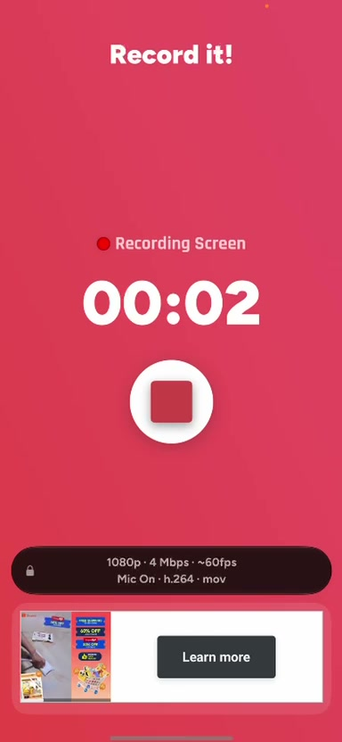
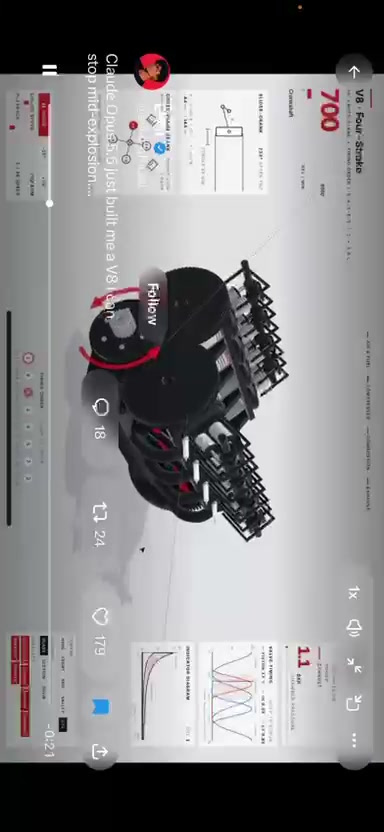
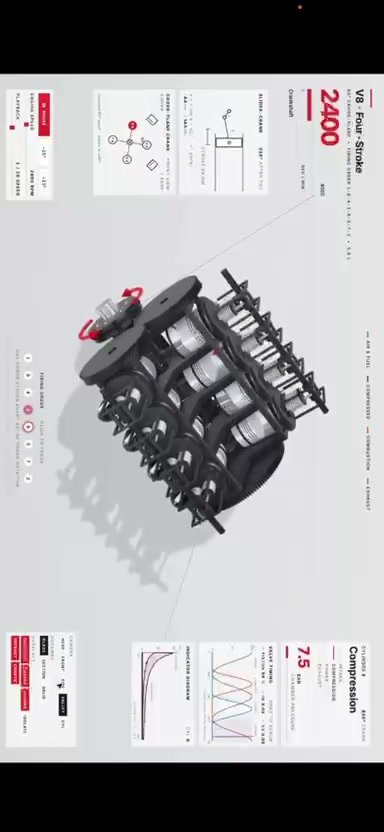
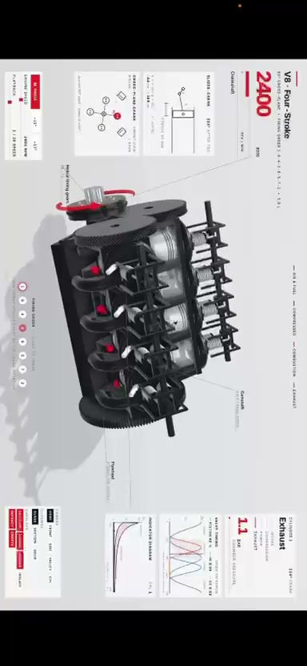

# ⚡ EVIE: Autonomous Hardware AI Co-Pilot

> *Inspired by Spider-Man's tactical AI assistant — synthesizes verified 3D-printable mechanical CAD from natural language, powered by NVIDIA Nemotron on Nebius Token Factory, Nebius AI Cloud & Tavily.*

[](LICENSE)
[](https://tokenfactory.nebius.com)
[](https://build.nvidia.com)
[](https://huggingface.co/nvidia/OpenMath-Nemotron-7B)
[](https://tavily.com)
[-brightgreen)](tests/)

---

## 📸 Spatial Studio in Action

| 🎮 3D WebGL Canvas & Multi-Tier Sizing | ⚙️ Real-Time Kinematics & Dynamic RPM |
|:---:|:---:|
|  |  |
| *Intake prompt, 3-tier sizing (Lightweight, Balanced, Heavy-Duty), and Three.js viewport.* | *Real-time slider-crank displacement $s(\theta)$ and dynamic RPM simulation (100–3000 RPM).* |

| 🧮 KaTeX Physics & Verified COTS BOM | 🔄 Closed-Loop Failure Feedback (REV 1.0 → 1.1) |
|:---:|:---:|
|  |  |
| *First-principles mechanics, shear/yield stress, and McMaster-Carr / MISUMI COTS BOM ($6.10).* | *Log test bench fractures (e.g. snapped at root) to automatically reinforce CAD to REV 1.1.* |

---

## 🚀 What is EVIE?

When engineers ask general-purpose LLMs to design physical hardware, models hallucinate math, invent impossible dimensions, and ignore basic physical laws.

**EVIE** bridges the gap between natural language ideas and physically viable hardware:

1. **Understands Mechanical Intent**: Converts mechanism briefs (or photos of broken parts) into concrete physical invariants, dimensional boundaries, and operating targets using **NVIDIA Nemotron-3-Super on Nebius Token Factory**.
2. **Grounds with Live Web Intelligence via Tavily**: Queries real-world engineering standards (e.g. *Machine Design*, *TEA planetary guides*) and commercial off-the-shelf (COTS) component catalogs (McMaster-Carr, MISUMI).
3. **Executes First-Principles Physics in Sandboxed Python**: Computes exact kinematics and load distributions (slider-crank displacement $s(\theta)$, peak piston acceleration $a_{max}$, shear and bending stresses) where math strictly overrules LLM hallucinations.
4. **Verifies via Dual NVIDIA Architecture**: A secondary **NVIDIA OpenMath-Nemotron** model on **Nebius AI Cloud** GPU infrastructure derives the governing mechanics step-by-step to cross-check Python calculations.
5. **Interactive 3D Spatial Studio**: Features a real-time WebGL canvas with interactive slider-crank kinematic animation, RPM control, Rest/Under Load/Exploded view inspections, and anisotropic 3D printing orientation analysis.
6. **Live COTS Bill of Materials**: Automatically generates itemized fastener, bearing, and dowel pin specifications with verified unit pricing and total hardware cost.
7. **Closed-Loop Physical Testing Iteration**: Log observed test bench failures (e.g. *"Snapped at root under shock load"*) to trigger automated failure mode diagnosis and bump CAD revisions (**REV 1.0 → REV 1.1**) with reinforced geometries.
8. **Production-Ready STL Export**: Generates watertight manifold, multi-part ASCII STL geometry directly sized for standard 3D printer beds.

---

## ⚡ How It Fits the Hackathon Rules

| Requirement | Implementation in EVIE |
|---|---|
| **Runtime Call to Nebius Token Factory** | `tesla_lab/llm.py` & `tesla_lab/nexa_engine.py` (OpenAI SDK, `base_url=https://api.tokenfactory.nebius.com/v1/`) |
| **NVIDIA Open Source Model** | `nvidia/nemotron-3-super-120b-a12b` (intent synthesis & failure diagnosis) and `nvidia/Nemotron-3_5-Lightning` |
| **Second NVIDIA Open Model** | `nvidia/OpenMath-Nemotron-7B` self-hosted on Nebius AI Cloud GPU VM via vLLM (`deploy/openmath/`) for symbolic mathematical derivations |
| **Tavily Sponsor Bonus ($3,000 Prize)** | `tesla_lab/nexa_engine.py` (`query_tavily_cots`): live McMaster-Carr & MISUMI COTS hardware sourcing with pricing and engineering standards |
| **Complete Product, Not a PoC** | Production WebGL spatial UI, real-time kinematic simulation, tactile Web Audio feedback, COTS BOM with dollar costs, watertight STL export |
| **Public Open Source License** | Apache 2.0 license file in repository root |

---

## 🏗️ System Architecture

```
User Mechanism Prompt ("V8 Cross-Plane Engine" / Broken Part Photo)
   │
   ▼
[1] Tavily COTS & Standards Search ── McMaster-Carr / MISUMI / Technical Standards
   │
   ▼
[2] Nebius Token Factory (NVIDIA Nemotron-3-Super 120B)
   │  ├── Archetype classification (Planetary Gearbox, Kinematic Engine, Gripper, Flexure)
   │  ├── Dimensional constraints & operating parameters
   │  └── Itemized COTS hardware BOM ($6.10 verified pricing)
   ▼
[3] First-Principles Python Physics Engine (kinematic_engine.py)
   │  ├── Invariant derivations: V_disp, mean piston speed, a_max = r·ω²·(1 + r/L)
   │  ├── Dynamic slider-crank kinematics s(θ) for all 8 cylinders across firing order
   │  └── Auto-scaling to 3D printer envelope (256mm Bambu bed)
   ▼
[4] Nebius AI Cloud: NVIDIA OpenMath-Nemotron 7B (deploy/openmath/)
   │  └── Derives governing equations step-by-step; cross-checks Python calculations
   ▼
[5] Interactive Spatial Studio (http://localhost:8080)
   │  ├── Three.js 3D WebGL Canvas (Rest, Under Load, Exploded views)
   │  ├── Real-time kinematic slider-crank animation with dynamic RPM tuning (100–3000 RPM)
   │  ├── KaTeX mathematical proof drawer & Anisotropy print orientation matrix
   │  └── Live COTS Hardware BOM & Supplier references
   ▼
[6] Closed-Loop Physical Testing Iteration (Tab 2: Testing Log)
   │  └── Log failure ("Snapped at root") → AI Diagnosis → Reinforce walls → REV 1.0 → REV 1.1
   ▼
[7] Watertight Multi-Part STL Export (downloadPhysicalSTL)
```

---

## 🏃 Run in 60 Seconds (Local Setup)

### 1. Clone & Setup Environment

```bash
git clone https://github.com/LeonoraAeolus/EVIE-.git
cd EVIE-
python -m venv .venv
# Windows:
.venv\Scripts\activate
# Linux/macOS:
source .venv/bin/activate

pip install -r requirements.txt
```

### 2. Configure API Keys (Optional for Live Mode)

Create a `.env` or `.env.local` file in the root directory:

```env
NEBIUS_API_KEY=your_nebius_token_factory_key
TAVILY_API_KEY=your_tavily_key
```

*(If keys are omitted, EVIE runs smoothly in verified offline fallback mode using pre-grounded mechanical archetypes.)*

### 3. Launch EVIE Spatial Studio

```bash
python scripts/run_nexa_ui.py
```

Opens your browser to **`http://localhost:8080`**.

---

## 🧪 Testing & Verification

EVIE includes an automated pytest suite covering kinematic equations, Tavily client integration, OpenMath LaTeX parsing, AST sandboxes, and STL generation:

```bash
pytest -q
# Output: 125 passed, 1 skipped (100% green)
```

---

## 📂 Project Structure

```
├── app.py                      # Master Streamlit unified application
├── scripts/
│   ├── run_nexa_ui.py          # Standalone server for Spatial Studio (Port 8080)
│   ├── check_nebius.py         # Diagnostic tool for Nebius Token Factory models
│   ├── check_tavily.py         # Diagnostic tool for Tavily API connection
│   └── run_eval.py             # 20-claim benchmark eval scoreboard
├── tesla_lab/
│   ├── kinematic_engine.py     # Slider-crank physics, 8-cylinder displacement, scaling
│   ├── kinematic_ui.html       # Standalone high-framerate V8 kinematic engine simulator
│   ├── nexa_engine.py          # Intent classification, COTS sourcing, failure revision engine
│   ├── nexa_spatial_ui.html    # Full Spatial WebGL Studio, KaTeX proofs & COTS BOM
│   ├── llm.py                  # Nebius Token Factory OpenAI-compatible client
│   ├── openmath.py             # NVIDIA OpenMath-Nemotron client on Nebius AI Cloud
│   ├── latexmath.py            # SymPy & LaTeX symbolic cross-checker
│   └── calcs/                  # Vetted first-principles analytical calculators
├── deploy/openmath/            # Nebius AI Cloud GPU VM creation & vLLM deployment scripts
├── docs/                       # High-resolution UI screenshots and spec PDFs
├── tests/                      # 125 unit & integration tests
└── LICENSE                     # Apache 2.0 Open Source License
```

---

## 📜 License

Distributed under the **Apache 2.0** License. See [`LICENSE`](LICENSE) for details.
